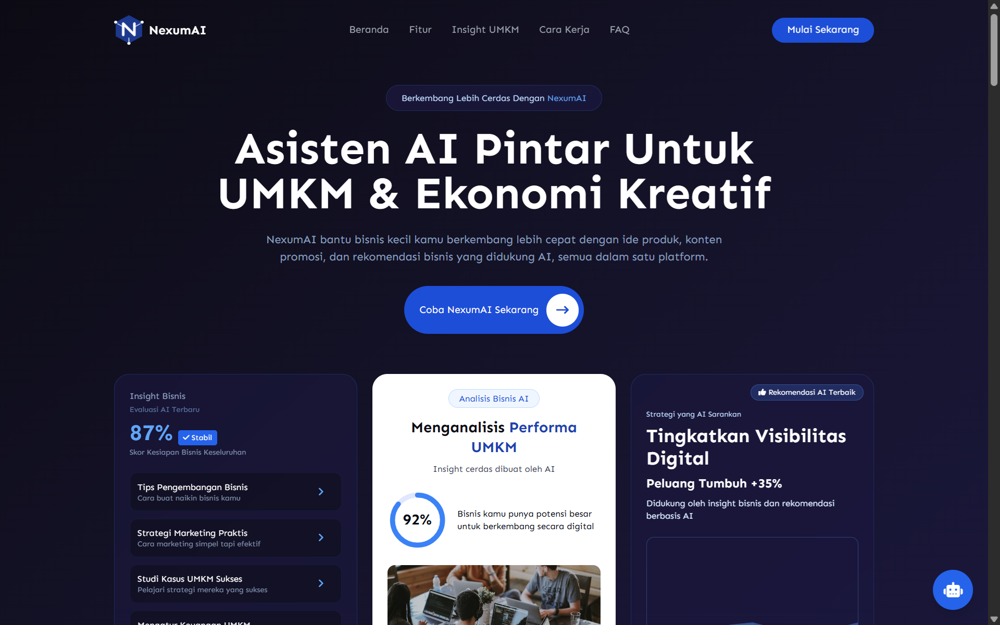
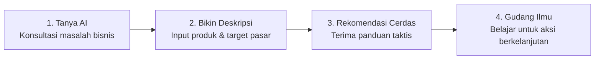

<div align="center">

# 🚀 NexumAI

### Berkembang Lebih Cerdas Dengan AI

**Asisten AI pintar untuk UMKM & Ekonomi Kreatif Indonesia**

[](https://nexumai-paras.vercel.app/)
[](https://nextjs.org/)
[](https://tailwindcss.com/)
[](https://ai.google.dev/)

[Live Demo](https://nexumai-paras.vercel.app/) · [Fitur](#-fitur-utama) · [Instalasi](#-memulai) · [Roadmap](#-roadmap)

<br />
<br />



</div>

---

## 📖 Tentang Proyek

**NexumAI** adalah platform _all-in-one_ berbasis Kecerdasan Buatan (AI) yang dirancang untuk mendampingi pemilik UMKM dan pelaku Ekonomi Kreatif di Indonesia.

### Masalah yang Diselesaikan

Banyak pelaku usaha kecil menghadapi kendala yang sama:

- Kesulitan menyusun strategi pemasaran yang efektif
- Keterbatasan waktu dan keahlian untuk membuat konten promosi yang persuasif
- Minimnya akses ke analisis data untuk mengambil keputusan bisnis yang tepat

### Solusi Kami

NexumAI menyediakan konsultasi bisnis berbasis AI, generator copywriting instan, analisis performa, rekomendasi taktis, dan gudang ilmu terintegrasi — semuanya dalam antarmuka yang ramah pengguna dengan bahasa yang mudah dipahami.

---

## ✨ Fitur Utama

| Fitur                             | Deskripsi                                                                                                                                          |
| --------------------------------- | -------------------------------------------------------------------------------------------------------------------------------------------------- |
| 🤖 **Asisten Bisnis AI**          | Konsultasi bisnis _real-time_ seputar penetapan harga, ide produk, strategi bundling, hingga manajemen operasional harian.                         |
| ✍️ **AI Copywriter**              | Mengubah draf sederhana menjadi deskripsi produk siap jual, _caption_ media sosial, dan _headline_ promosi dalam hitungan detik.                   |
| 📊 **Evaluasi & Analisis Bisnis** | Menghasilkan _Business Readiness Score_, insight potensi digital, dan tren pertumbuhan bulanan secara visual dan terukur.                          |
| 💡 **Rekomendasi Pintar**         | Kartu saran taktis (visibilitas digital, promo jam sibuk, desain kemasan) lengkap dengan estimasi _growth impact_.                                 |
| 📚 **Gudang Ilmu UMKM**           | Pusat referensi strategi marketing praktis, panduan arus kas (_cash flow_), dan studi kasus UMKM sukses yang terhubung dengan konteks analisis AI. |

---

## 🔄 Alur Penggunaan



1. **Tanya AI soal bisnis** — Mulai dengan bahasa sehari-hari, tanpa istilah teknis yang rumit.
2. **Bikin deskripsi produk & promosi** — Masukkan parameter singkat, dapatkan konten siap pakai.
3. **Dapatkan rekomendasi bisnis** — Terima _actionable cards_ dengan estimasi peluang pertumbuhan (misalnya: _Peluang Tumbuh +35%_).
4. **Belajar lewat Gudang Ilmu** — Perluas wawasan dengan artikel dan studi kasus UMKM yang kontekstual.

---

## 🛠️ Teknologi

| Kategori           | Teknologi                                           |
| ------------------ | --------------------------------------------------- |
| **Frontend & UI**  | React / Next.js, Tailwind CSS                       |
| **AI Integration** | Google Gemini API (_contextual business prompting_) |
| **Deployment**     | Vercel                                              |

---

## 🚀 Memulai

### Prasyarat

- [Node.js](https://nodejs.org/) versi 18 atau lebih baru
- npm / yarn / pnpm
- API key [Google Gemini](https://aistudio.google.com/app/apikey)

### Instalasi

```bash
# 1. Clone repositori
git clone https://github.com/<username>/<nama-repo>.git
cd <nama-repo>

# 2. Install dependensi
npm install

# 3. Salin file environment
cp .env.example .env.local
```

### Konfigurasi Environment

Buka `.env.local` lalu isi dengan API key Anda:

```env
GEMINI_API_KEY=your_gemini_api_key_here
```

> ⚠️ **Jangan pernah** meng-commit file `.env.local` atau membagikan API key Anda secara publik.

### Menjalankan Aplikasi

```bash
# Mode development
npm run dev

# Build untuk production
npm run build
npm start
```

Buka [http://localhost:3000](http://localhost:3000) di browser Anda.

---

## 🗂️ Struktur Proyek

> Sesuaikan dengan struktur folder proyek Anda.

```
nexumai/
├── app/                # Halaman & routing (Next.js)
├── components/         # Komponen UI reusable
├── lib/                # Utilitas & integrasi Gemini API
├── public/             # Aset statis
├── .env.example        # Contoh konfigurasi environment
└── README.md
```

---

## 🗺️ Roadmap

- [x] Asisten Bisnis AI (chat)
- [x] AI Copywriter
- [x] Evaluasi & Analisis Bisnis
- [x] Rekomendasi Pintar
- [x] Gudang Ilmu UMKM
- [ ] Autentikasi & profil pengguna
- [ ] Penyimpanan riwayat konsultasi
- [ ] Integrasi marketplace & media sosial
- [ ] Dukungan bahasa daerah
- [ ] Ekspor laporan analisis (PDF)

---

## 🤝 Kontribusi

Kontribusi sangat disambut! Untuk berkontribusi:

1. _Fork_ repositori ini
2. Buat _branch_ fitur (`git checkout -b fitur/fitur-baru`)
3. _Commit_ perubahan (`git commit -m "Menambahkan fitur baru"`)
4. _Push_ ke _branch_ (`git push origin fitur/fitur-baru`)
5. Buka _Pull Request_

---

## 🏆 Penghargaan & Event

Proyek ini dikembangkan dan dipresentasikan pada **PARAS ICT XI 2026**, diselenggarakan oleh **Universitas INSTIKI** (Institut Bisnis dan Teknologi Indonesia) pada 20 Februari 2026.

---

## 📄 Lisensi

Hak Cipta © 2026 **NexumAI Team**. Seluruh hak dilindungi.

> Ingin membuka proyek ini sebagai _open source_? Tambahkan file `LICENSE` (misalnya MIT) dan perbarui bagian ini.

---

## 📬 Kontak

**NexumAI Team**

- 🌐 Website: [nexumai-paras.vercel.app](https://nexumai-paras.vercel.app/)
- 📧 Email: `email@anda.com`
- 💼 GitHub: [@username](https://github.com/username)

<div align="center">

**Dibuat dengan ❤️ untuk kemajuan UMKM Indonesia**

</div>
